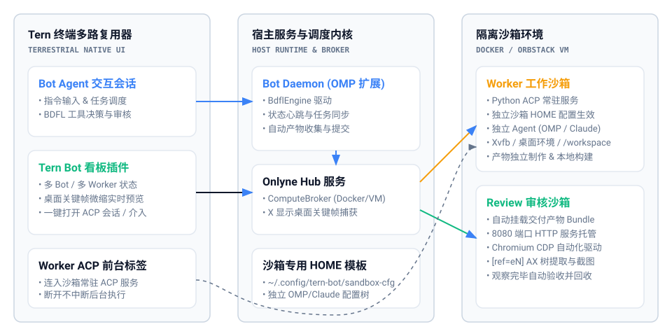
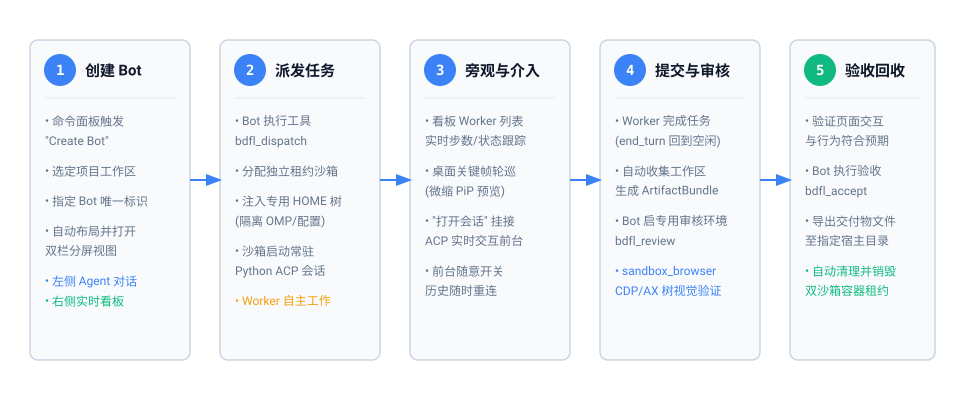

# Tern Bot

Tern Bot 是专为 [Tern](https://tern.tools) 终端多路复用器打造的个人 BDFL（Benevolent Dictator for Life）智能调度助手。它将 **Bot 调度会话**、**多 Bot / 多 Worker 状态看板**、**沙箱桌面微缩关键帧预览** 以及 **沙箱内 Agent 的独立 ACP 会话** 深度整合到同一个原生 Tern 窗口中。

通过将编码与执行委派给容器隔离沙箱中的 Worker Agent，并在专用的 Review 沙箱中进行 Chromium CDP / 无障碍（AX）树全自动验收，主工作区免受脏代码和不可控副作用污染。

---

## 系统架构



---

## 核心特性

- **多 Bot 独立调度**：每个项目或工作区可拥有专属 Bot。Bot 作为项目 BDFL 负责任务派发、进度监督与验收，而非在宿主环境堆砌代码。
- **沙箱隔离与环境自包含**：
  - 基于 Debian 12 + Xvfb 桌面 + Chromium + Python 3 + Bun 构建的标准沙箱镜像 (`tern-bot-sandbox:dev`)。
  - 沙箱使用独立的 `$HOME` 模板（默认位于 `~/.config/tern-bot/sandbox-cfg`），通过 stdin 串流打包解压，严格隔离宿主配置与私有密钥。
- **常驻 Worker ACP 会话**：
  - Worker 容器内运行 Python ACP 常驻服务，解耦前台与后台生命周期。
  - Tern 前台关闭标签仅断开连接，Worker 在沙箱内持续执行；点击“打开会话”随时重连并自动同步完整历史。
- **桌面关键帧实时预览**：
  - Hub 服务定时直接捕获 Worker 沙箱 Xvfb 显示画面（480px JPEG），在看板中提供低延迟桌面微缩预览。
  - 支持随时点击弹出无延迟实时画中画（PiP）或请求人工接管。
- **端到端自动化验收机制**：
  - Worker 正常交付后自动打包 `ArtifactBundle` 进入 `SUBMITTED` 状态。
  - Bot 唤起专用 Review 沙箱（8080 端口 HTTP 托管交付物），通过 CDP 提取 `[ref=eN]` 交互元素并驱动操作，确认行为符合预期后才允许 `bdfl_accept` 并回收所有沙箱。

---

## 全生命周期流程



---

## 组件清单

本仓库包含全套 tern-bot 核心组件，并已按模块解耦发布至 npm：

| 模块目录 | 角色职责 |
|---|---|
| `packages/tern-plugin` (`@dbydd/tern-plugin`) | Tern 原生插件（Luau + TypeScript Hub），包含看板 Block、命令面板动作、桌面截图捕获。 |
| `packages/bot-daemon` (`@dbydd/bot-daemon`) | Bot 宿主守护进程（OMP 扩展），提供状态同步心跳、上下文计量与 BDFL 调度工具。 |
| `packages/bdfl-engine` (`@dbydd/bdfl-engine`) | 引擎核心层：负责计算租约申请、产物收集提交、Review 浏览器控制与 Worker Agent 常驻连接。 |
| `packages/tavern-harness` (`@dbydd/tavern-harness`) | 上下文窗口预算与滑动压缩管理，保障会话在长周期调度下稳定可控。 |
| `packages/sandbox-image` | 隔离沙箱 Dockerfile 与入口脚本（支持 Xvfb、noVNC 桌面、Chromium CDP 与 ACP 运行时）。 |
| `templates/sandbox-cfg` | 沙箱专用 Agent HOME 配置模板样例（脱敏版）。 |
| `scripts/` & `install.sh` | 一键自动化安装、依赖校验、镜像构建与插件链接脚本。 |

---

## 快速安装

### 前置要求

- macOS (推荐) 或 Linux
- [Bun](https://bun.sh) (>= 1.1)
- [Docker](https://www.docker.com/) 或 [OrbStack](https://orbstack.dev/) (用于沙箱容器隔离)
- Python 3 (用于宿主机与沙箱的 ACP 中继)
- [Tern](https://tern.tools) 终端多路复用器

### 一键安装脚本

在项目根目录下执行安装脚本：

```bash
./install.sh
```

安装脚本将自动执行以下步骤：
1. 检测并校验 Bun、Docker、Python3、Tar 等前置环境；
2. 安装根工作区依赖并执行代码类型检查 (`bun run check`)；
3. 构建沙箱 Docker 镜像 `tern-bot-sandbox:dev`；
4. 初始化沙箱 Agent 的专用 HOME 模板目录 (`~/.config/tern-bot/sandbox-cfg`)；
5. 将插件链接至 Tern (`tern plugin link packages/tern-plugin`) 并重载。

---

## 配置指南

### 1. 沙箱 Agent 的 HOME 配置

沙箱内的 Agent（如 `omp acp` 或 `claude-code-acp`）运行在完全独立的沙箱 `$HOME` 下。其配置来自于宿主机模板目录（默认为 `~/.config/tern-bot/sandbox-cfg/`，可通过环境变量 `TERN_BOT_SANDBOX_CFG` 调整）：

```
~/.config/tern-bot/sandbox-cfg/
  ├── .omp/agent/
  │     ├── config.yml     # 沙箱 Agent 运行模式、工具自动放行 (approvalMode: yolo)
  │     └── models.yml     # 沙箱 Agent 所调用的模型服务配置
  └── ... (可扩展支持 .claude 等其它 CLI 配置)
```

在派发任务时，该目录会被安全打包并通过 exec stdin 注入容器解包。容器内的 Agent 只能访问该模板中的配置，不会读取宿主机的个人配置或敏感私钥。

### 2. 沙箱 Agent CLI 命令

通过环境变量 `TERN_BOT_WORKER_AGENT` 指定沙箱内启动的 Agent 命令：

```bash
# 默认使用 OMP ACP 模式
export TERN_BOT_WORKER_AGENT='["omp", "acp"]'

# 或切换至其他 ACP 兼容器
export TERN_BOT_WORKER_AGENT="claude-code-acp"
```

---

## 使用教程

1. **在 Tern 中创建 Bot**：
   - 按 `Cmd + P` 打开 Tern 命令面板，输入 `Create Bot`。
   - 输入目标工作区路径（例如 `/path/to/project`）以及 Bot 唯一标识（例如 `my-project-bot`）。
   - Tern 将自动打开该 Bot 的分屏视图：左侧为 Bot 对话交互，右侧为 Tern Bot 实时状态看板。

2. **派发子任务**：
   - 在 Bot 交互对话中直接要求其调度 Worker：
     > *"请在沙箱中创建一个展示页面，并在标题下方放置一个计数按钮。"*
   - Bot 会调用 `bdfl_dispatch` 启动工作沙箱，右侧看板即时显示 `worker-1` 运行状态与桌面关键帧。

3. **旁观与介入**：
   - 选中看板中的任意 Worker，可实时查看沙箱桌面微缩截图。
   - 点击“打开会话”，Tern 将自动新开标签挂载该 Worker 的实时 ACP 交互终端，可随时输入补充指令或观察工具执行。关闭前台标签不影响后台沙箱继续工作。

4. **自动化审核与验收**：
   - Worker 完成制作后，看板自动跳转为 `SUBMITTED ★审阅`。
   - Bot 自动唤起 Review 沙箱并使用 `sandbox_browser` 访问页面元素完成验证。
   - 验证通过后，Bot 调用 `bdfl_accept` 将产物自动导出至指定目录，并销毁临时沙箱容器。

---

## 开发与自测

运行工作区所有模块的类型检查：

```bash
bun run check
```

## 发布到 npm

四个子包都已配置 `publishConfig.access = "public"`，按依赖顺序发布即可：

```bash
./scripts/publish.sh --dry   # 先看会发布哪几个包，不实际发布
./scripts/publish.sh         # 真正发布，已存在同名版本的包自动跳过
```

发布顺序由脚本保证：`@dbydd/tavern-harness` → `@dbydd/bdfl-engine`
→ `@dbydd/tern-plugin` → `@dbydd/bot-daemon`。
`@onlyne/*` 底层库不在本仓库的发布范围内。

---

## 开源许可

[MIT](LICENSE)
